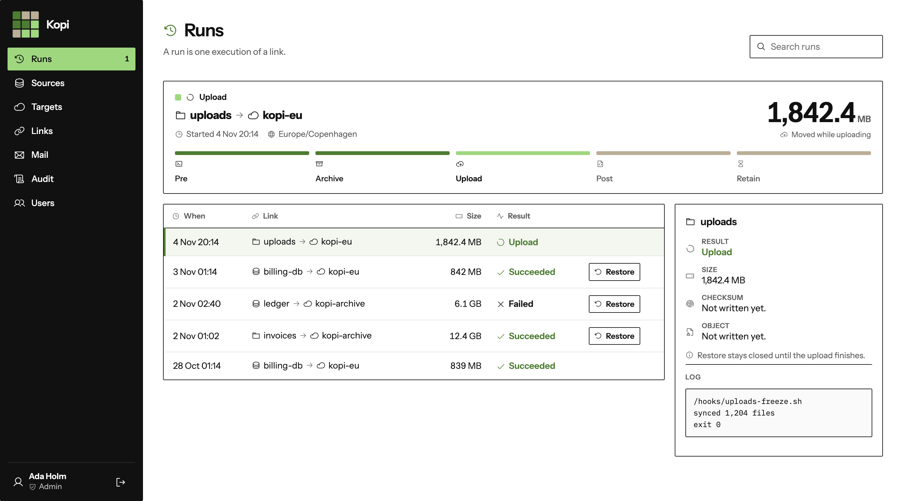
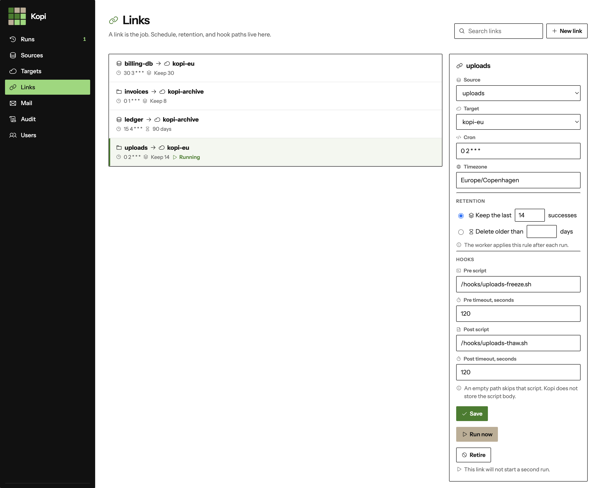
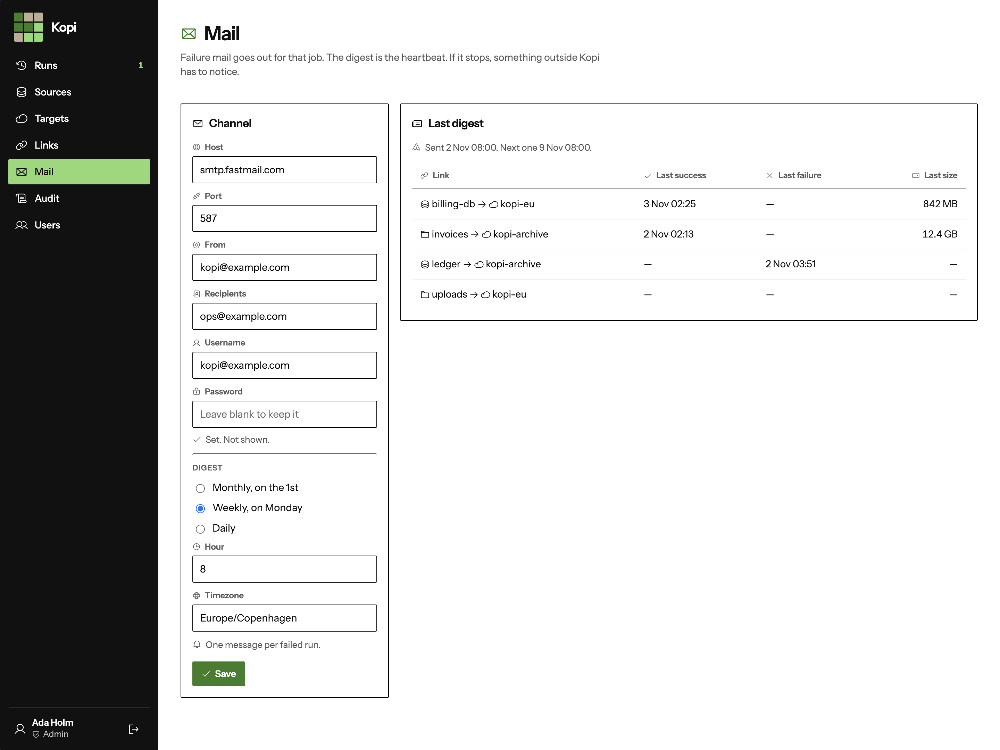
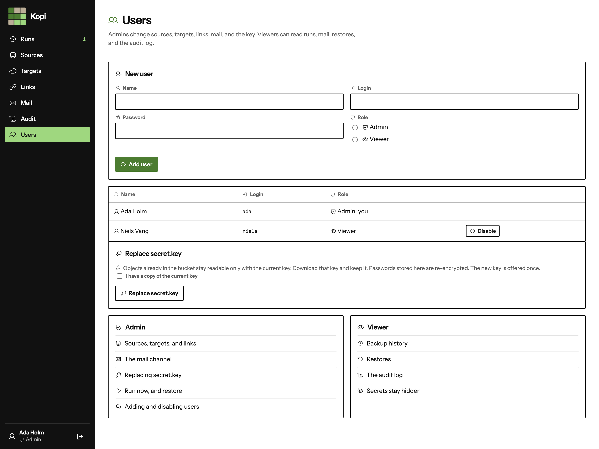
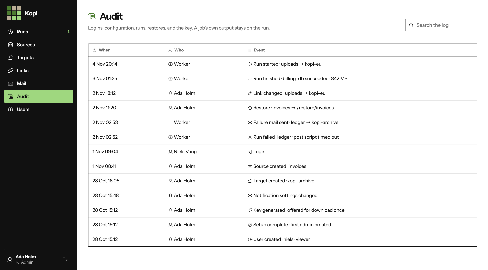

# Kopi

Kopi backs up Postgres databases and folders to S3. The host encrypts every backup before upload, so the bucket stores ciphertext.



The screens are a sample install. `uploads` is in the upload phase, and the figure is the megabytes that phase has moved. Restore stays closed until the object is written. A run that failed after a successful upload can still be restored: `ledger` is failed, and the ciphertext is still there. Retention has already removed the 28 Oct backup of `billing-db`.

A run is one pass over a link. Pre script, then the dump or the archive, then age, then the upload, then the post script, then the retention rule.

## The job is a link



A **source** is one Postgres database or one folder tree. A **target** is an S3 bucket. A **link** connects one source to one target and holds the schedule, the retention rule, and the optional script paths. One source can ship to several buckets. One bucket can receive several sources.

The scripts stay on disk. Kopi runs each as `bash <path>`, as the Kopi user. An empty path skips that script. The backup starts only when the pre script exits 0. The post script still runs when the backup itself fails. A successful upload is kept if the post script then fails. The run is marked failed, and the failure mail goes out.

One link does not overlap itself. The worker runs one backup at a time. A backup that moves no bytes for 15 minutes fails.

## Ciphertext, with a name you can read

```text
folder or database
        │
        ▼
 tar | zstd    or    pg_dump -Fc
        │
        ▼
       age                  secret.key stays on the host
        │
        ▼
   S3 object
```

```text
uploads/2026-11-04T19:08:12Z/<sha256>
```

The object name carries the source, the time, and the checksum. A listing of the bucket is readable without the app database. The payload is encrypted.

`secret.key` is never part of a backup. A folder source that would include that file skips it. The first-run screen generates the key and offers a download once. Keep that copy outside any folder source. The backups cannot be decrypted without it.

Postgres passwords and S3 credentials are stored in the app database, encrypted with the same key.

## The digest is the heartbeat



A failed run sends one message for that job. The digest lists, per link, the last success, the last failure, and the last size. If the digest stops arriving, Kopi is down, and something outside Kopi has to notice.

## Two roles, one key



An admin manages sources, targets, links, mail, users, and the key. A viewer can read backup history, restores, and the audit log. Secrets stay hidden.

Replacing the key re-encrypts the passwords stored in Kopi and offers the new key once. Objects already in the bucket stay readable only with the key that wrote them.

## The audit log



Sign-in, setup, configuration, runs, restores, and the key are recorded here. A job's own output stays on the run.

## Run the image

Kopi is one container. It serves the site and runs the worker. The image is stateless. A data volume holds SQLite, `secret.key`, and the separate key Django uses to sign sessions. A work volume holds the ciphertext while it is encrypted and uploaded, and it has to fit the largest backup. A restore downloads that ciphertext again before it writes plaintext, so leave room for the file.

Folder sources and pre/post scripts are bind mounts. A path saved in the UI is a path inside the container.

```yaml
services:
  kopi:
    image: kopi
    ports:
      - "127.0.0.1:8443:8443"
    environment:
      KOPI_ALLOWED_HOSTS: kopi.example
      KOPI_TLS_CERT: /cert/tls.crt
      KOPI_TLS_KEY: /cert/tls.key
    volumes:
      - kopi_data:/data
      - kopi_work:/work
      - ./tls:/cert:ro
      - ./uploads:/srv/uploads:ro
      - ./hooks:/hooks:ro
      - ./restore:/restore
    stop_grace_period: 40s
```

The process listens on `8443`. `KOPI_ALLOWED_HOSTS` is required. The site is HTTPS from the mounted certificate. `docker stop` needs about 30 seconds. The worker stops claiming new runs and lets the one in progress shut down.

The operator guide is [Operate](docs/operate.md). It covers first run, sources, schedules, scripts, restore, mail, and what is lost if `secret.key` is lost.

## Development harness

Postgres 18 and Garage run in Docker Compose. The Django project stores SQLite in `./devdata/data`. `./devdata` is bind-mounted so a worker on the host can see data and work files. Postgres and Garage keep named volumes.

Dev credentials are in `.env.example`. The image build leaves them out.

```sh
export KOPI_ALLOW_HTTP=1
docker compose up -d
```

`KOPI_ALLOW_HTTP=1` lets the development server accept plain HTTP. The image serves HTTPS.

Postgres is published on `127.0.0.1:5432`. Garage's S3 API is published on `127.0.0.1:3900`. boto3 uses that endpoint, path-style addressing, and the `garage` region. The `garage-init` container assigns the layout and creates the bucket and access key. It is safe to run again.

`POSTGRES_PORT` changes the published Postgres port when 5432 is already taken. Compose reads that override from `.env`. The host `pg_dump` has to be Postgres 18 or newer. Encryption tests need `age` and `age-keygen` on the host.

`garage-init` exits 0 once the bucket and access key exist. `docker compose up --wait` can return non-zero, because that container is meant to exit.

`docker compose up` starts Postgres and Garage. The Kopi image is on the `app` profile. `harness/image-cert.sh` writes a throwaway certificate under `devdata/cert`. That key is not committed.

```sh
harness/image-cert.sh
docker compose --profile app up -d --build
```

The image listens on `https://127.0.0.1:8443/`. Ward tests tagged `integration` skip when Compose is not up. Tests tagged `image` skip unless that port answers. On a fresh data volume the image test runs setup. After that it signs in as `admin` with password `kopi-image-pass`.

```sh
ward
```

## Further reading

- [Spec](docs/specsheet.md)
- [Stack](docs/techstack.md)
- [Roadmap](docs/roadmap.md)
- [Phase 1](docs/phase-1.md)
- [Phase 2](docs/phase-2.md)
- [Phase 3](docs/phase-3.md)
- [Phase 4](docs/phase-4.md)
- [Phase 5](docs/phase-5.md)
